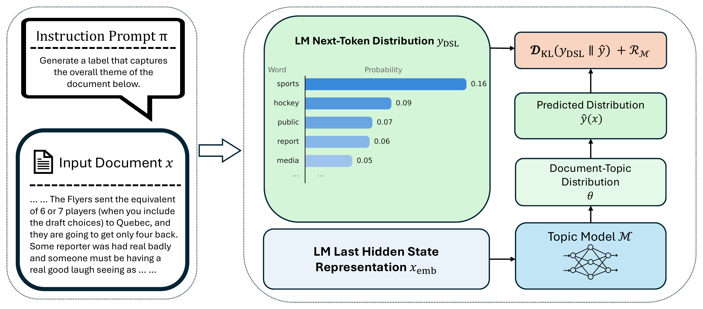
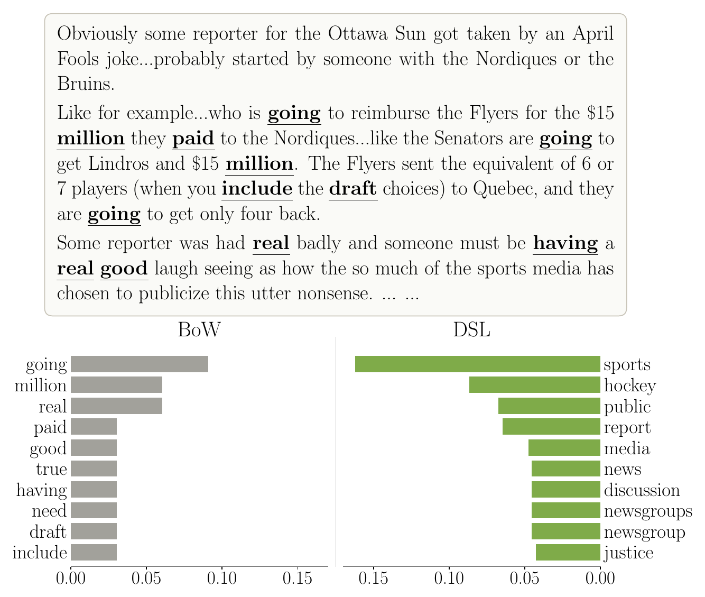
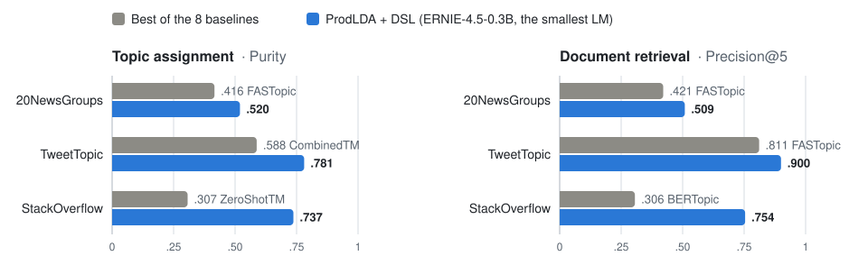

<div align="center">

<picture>
  <source media="(prefers-color-scheme: dark)" srcset="assets/dsl-logo-dark.svg">
  
</picture>

<h3>Improving Topic Modeling by Distilling Soft Labels from Language Models</h3>

<p>
<b>Raymond Li</b> &nbsp;·&nbsp;
<b>Amirhossein Abaskohi</b> &nbsp;·&nbsp;
<b>Chuyuan Li</b> &nbsp;·&nbsp;
<b>Gabriel Murray</b> &nbsp;·&nbsp;
<b>Giuseppe Carenini</b>
<br>
University of British Columbia
</p>

<p>
<a href="https://proceedings.mlr.press/v306/li26a.html"></a>
<a href="https://raw.githubusercontent.com/mlresearch/v306/main/assets/li26a/li26a.pdf"></a>
<a href="LICENSE"></a>
<br>


<a href="https://huggingface.co/raymondzmc"></a>
<a href="https://openreview.net/forum?id=S2PARGuQzI"></a>
<a href="https://github.com/raymondzmc/dsl-topic-models/stargazers"></a>
</p>

<p>
<a href="https://proceedings.mlr.press/v306/li26a.html"><b>Paper</b></a> ·
<a href="#-quick-start"><b>Quick start</b></a> ·
<a href="#-how-dsl-works"><b>Method</b></a> ·
<a href="#-results"><b>Results</b></a> ·
<a href="#-reproducing-the-paper"><b>Reproduce</b></a> ·
<a href="#-citation"><b>Citation</b></a>
</p>

</div>

---

## 🔥 News

- **[2026-09]** The paper is published in the ICML 2026 proceedings ([PMLR 306](https://proceedings.mlr.press/v306/li26a.html)).
- **[2026-07]** DSL is presented at **ICML 2026** in Seoul.
- **[2026-06]** Code release, with the 15 processed datasets used in the main experiments and one script per table.

## 💡 Overview

Neural topic models are usually trained to reconstruct a document's bag-of-words. That target only counts the words that appear in the document, so it ignores context and carries very little signal for short texts such as tweets or question titles.

**DSL** replaces that target. A small language model reads the document together with a one-line instruction asking for its theme, and its next-token distribution, restricted to the topic-model vocabulary, becomes a dense soft label. The topic model is trained to reconstruct this soft label from the LM's last hidden state. Nothing else about the topic model changes, so you still get document-topic and topic-word distributions.

<p align="center">
  
</p>

## ✨ Highlights

- 🧩 **A drop-in training target.** DSL changes the reconstruction target and the input, and keeps the topic model's architecture and regularizer. The paper applies it to ProdLDA, ECRTM and FASTopic.
- 🏆 **Higher assignment accuracy in every setting tested.** All 45 DSL configurations (3 backbones × 5 LMs × 3 datasets) score above the best of 8 baselines on Purity. On StackOverflow the best baseline reaches .307 and ProdLDA + DSL reaches .698 to .803, depending on the LM.
- 🔎 **Topic distributions that work for retrieval.** ProdLDA + DSL and ECRTM + DSL beat every baseline on Precision@5 and Precision@10 on all three datasets, with every LM.
- 🪶 **A 0.3B-parameter LM is enough.** The chart below uses ERNIE-4.5-0.3B, the smallest of the five LMs. The LM runs once per document, and training reads the cached outputs.
- 📦 **Processed datasets are released.** The soft labels and hidden states for 3 datasets × 5 LMs are on the Hugging Face Hub and download on first use.
- 🔁 **One script per table.** Main results, retrieval and all eight ablations each have a launch script.

## 🔍 Example

A 20NewsGroups post about a hockey trade rumor, from Figure 1 of the paper. The bag-of-words target (left) can only weight words that occur in the post, such as "going" and "million". The DSL target (right) puts most of its mass on "sports" and "hockey", although the excerpt never mentions hockey by name.

<p align="center">
  
</p>

The learned topics differ in the same way. Below is the topic each method aligns with the *sci.med* class of 20NewsGroups at K = 75, with its per-topic C<sub>V</sub> coherence (paper, Table 4; DSL uses ERNIE-4.5-0.3B).

| Method | Topic C<sub>V</sub> | Top-15 words |
|:--|:-:|:--|
| ProdLDA | .467 | oil, water, battery, pain, temperature, cause, food, reaction, weight, heat, cold, air, pressure, brain, effects |
| BERTopic (best baseline here) | .821 | patients, disease, health, doctor, medical, cancer, vitamin, treatment, infection, patient, diet, pain, doctors, insurance, food |
| **ProdLDA + DSL** | **.877** | clinical, doctor, medical, disease, treatment, patient, symptoms, doctors, infection, pain, body, medicine, care, patients, cancer |

<details>
<summary><b>All nine methods</b></summary>
<br>

| Method | Topic C<sub>V</sub> | Top-15 words |
|:--|:-:|:--|
| LDA | .325 | pain, problem, doctor, effect, fat, reaction, recall, extremely, like, happen, pictures, ago, paper, sorry, think |
| ProdLDA | .467 | oil, water, battery, pain, temperature, cause, food, reaction, weight, heat, cold, air, pressure, brain, effects |
| ZeroShotTM | .815 | doctor, pain, medical, patient, symptoms, treatment, doctors, medicine, tests, diet, patients, literature, sick, day, vitamin |
| CombinedTM | .497 | water, brain, food, blood, fat, heart, cause, energy, doctor, effects, heat, pain, reaction, eat, levels |
| ETM | .342 | new, problem, high, end, large, cost, found, long, level, comes, numbers, number, problems, price, year |
| BERTopic | .821 | patients, disease, health, doctor, medical, cancer, vitamin, treatment, infection, patient, diet, pain, doctors, insurance, food |
| ECRTM | .705 | doctor, vitamin, blood, cancer, brain, describes, patients, causes, infection, symptoms, disease, age, gain, diet, women |
| FASTopic | .356 | easier, comparison, differences, requirements, usually, reduce, compare, fairly, slightly, limit, easily, advantage, require, equivalent, depends |
| **ProdLDA + DSL** | **.877** | clinical, doctor, medical, disease, treatment, patient, symptoms, doctors, infection, pain, body, medicine, care, patients, cancer |

</details>

## 🧠 How DSL works

**1. Ask the LM for the theme, and keep the distribution.** Each document $x$ is placed in a short prompt $\pi$. The shipped default is [`instructions/default.jinja`](src/dsl_topic/prompts/templates/instructions/default.jinja) inside [`document_topic_distribution.jinja`](src/dsl_topic/prompts/templates/document_topic_distribution.jinja):

```text
Generate a label that capture the overall theme of the document below.

Document: {document}

Topic:
```

The label is never decoded. `dsl-process` takes the next-token logits after `Topic:` and keeps the entries for the vocabulary $V$ (the 2,000 most frequent words after stop-word removal). A temperature-scaled softmax turns them into the soft label:

```math
y_{\mathrm{DSL}}(x,\pi)=\mathrm{softmax}\left(\frac{\ell_V(x,\pi)}{\tau}\right)
```

**2. Use the LM's last hidden state as the document representation.** The final-layer hidden state at the last prompt position, $`x_{\mathrm{emb}}`$, is the topic model's input. It is the same vector the LM head turns into those logits.

**3. Train the topic model to reconstruct the soft label.** The bag-of-words reconstruction term is replaced by a KL term. The model's own regularizer $`\mathcal{R}_{\mathcal{M}}`$ stays: the prior KL in ProdLDA, embedding clustering in ECRTM, the transport terms in FASTopic.

```math
\mathcal{L}_{\mathrm{DSL}}(x)=\lambda D_{\mathrm{KL}}\left(y_{\mathrm{DSL}}(x,\pi)\ \Vert\ \hat{y}_{\psi}(x)\right)+\mathcal{R}_{\mathcal{M}}(x;\psi)
```

The paper uses $\tau = 3$ and $\lambda = 10^3$, which are the `dsl-train` defaults (`--temperature`, `--loss_weight`). The loss is [`distillation_loss`](src/dsl_topic/models/dsl/_objective.py) and is shared by all DSL backbones.

## 📊 Results

<p align="center">
  <picture>
    <source media="(prefers-color-scheme: dark)" srcset="assets/results-dark.svg">
    
  </picture>
</p>

Each bar is a mean over K ∈ {25, 50, 75, 100} and 5 seeds (paper, Tables 1 and 2). The gains are largest on the two short-text datasets. On StackOverflow, where documents average 9 words, Purity goes from .307 to .737 and Precision@5 from .306 to .754.

Where DSL does not help:

- **Diversity.** I-RBO for ProdLDA + DSL is .976 to .994, against .991 to .994 for ProdLDA. The temperature trades coherence against diversity (paper, Section 5.2).
- **FASTopic.** FASTopic + DSL improves Purity, but on 20NewsGroups it trails the FASTopic baseline on C<sub>V</sub> and LLM rating, and on TweetTopic its retrieval is worse (P@5 falls from .811 to between .612 and .627). The paper attributes this to the optimal-transport objective spreading mass under a dense target.

The paper recommends **ProdLDA + DSL** as the default: it is the simplest backbone and stays close to ECRTM + DSL.

<details>
<summary><b>Full main results</b> (paper, Table 1)</summary>
<br>

Top-15 words, mean over K ∈ {25, 50, 75, 100} × 5 seeds. **Bold** marks the best method per column and those not significantly different from it (Welch's t-test, α = 0.05). 20NG = 20NewsGroups, Tweet = TweetTopic, SO = StackOverflow.

| Method | 20NG C<sub>V</sub> | 20NG LLM | 20NG I-RBO | 20NG Purity | Tweet C<sub>V</sub> | Tweet LLM | Tweet I-RBO | Tweet Purity | SO C<sub>V</sub> | SO LLM | SO I-RBO | SO Purity |
|:--|--:|--:|--:|--:|--:|--:|--:|--:|--:|--:|--:|--:|
| ***Baselines*** | | | | | | | | | | | | |
| LDA | .341 | 2.22 | .977 | .301 | .350 | 1.95 | .992 | .441 | .354 | 2.00 | .977 | .174 |
| ProdLDA | .351 | 2.49 | .992 | .356 | .355 | 2.11 | .994 | .533 | .352 | 2.62 | .991 | .265 |
| CombinedTM | .351 | 2.57 | .993 | .391 | .360 | 2.36 | .988 | .588 | .364 | 2.85 | .986 | .306 |
| ZeroShotTM | .354 | 2.53 | .994 | .397 | .356 | 2.30 | .994 | .573 | .363 | 2.84 | .993 | .307 |
| ETM | .344 | 2.35 | .934 | .360 | .351 | 2.22 | .936 | .552 | .348 | 2.28 | .934 | .151 |
| BERTopic | .360 | 2.48 | .992 | .352 | .364 | 2.19 | .996 | .562 | .374 | 2.63 | .996 | .202 |
| ECRTM | .360 | 2.28 | .999 | .364 | .356 | 1.85 | **1.000** | .399 | .373 | 1.95 | **1.000** | .062 |
| FASTopic | .358 | 2.59 | .999 | .416 | .276 | 1.96 | .626 | .557 | .363 | 2.30 | .687 | .171 |
| ***ProdLDA + DSL*** | | | | | | | | | | | | |
| ERNIE-4.5-0.3B | .381 | 2.86 | .991 | .520 | .392 | 2.90 | .989 | **.781** | .397 | 2.91 | .986 | .737 |
| Qwen-3.5-0.8B | .399 | 2.86 | .980 | .542 | .401 | 2.86 | .976 | **.781** | .403 | 2.89 | .983 | .788 |
| Llama-3.2-1B | .377 | **2.89** | .991 | .564 | .387 | **2.92** | .992 | **.784** | .395 | **2.95** | .991 | .698 |
| Phi-3-mini | .370 | 2.70 | .994 | .557 | .386 | 2.63 | .994 | **.787** | .404 | 2.86 | .988 | **.803** |
| Llama-3.1-8B | .364 | **2.87** | .993 | .559 | .384 | 2.88 | .993 | .774 | .386 | **2.96** | .991 | .700 |
| ***FASTopic + DSL*** | | | | | | | | | | | | |
| ERNIE-4.5-0.3B | .344 | 2.24 | **1.000** | .510 | .359 | 2.04 | 1.000 | .702 | .384 | 2.27 | **1.000** | .508 |
| Qwen-3.5-0.8B | .347 | 2.15 | 1.000 | .504 | .360 | 1.97 | 1.000 | .695 | .389 | 2.29 | 1.000 | .537 |
| Llama-3.2-1B | .337 | 2.20 | **1.000** | .541 | .357 | 2.03 | 1.000 | .703 | .390 | 2.32 | 1.000 | .530 |
| Phi-3-mini | .336 | 2.04 | 1.000 | .499 | .353 | 1.96 | 1.000 | .705 | .395 | 2.31 | 1.000 | .538 |
| Llama-3.1-8B | .347 | 2.07 | 1.000 | .555 | .355 | 2.01 | 1.000 | .708 | .395 | 2.30 | 1.000 | .542 |
| ***ECRTM + DSL*** | | | | | | | | | | | | |
| ERNIE-4.5-0.3B | .404 | 2.82 | .985 | .521 | .398 | 2.82 | .983 | .767 | **.410** | 2.85 | .988 | .742 |
| Qwen-3.5-0.8B | **.423** | 2.82 | .975 | .561 | **.406** | 2.82 | .977 | **.781** | .406 | 2.86 | .984 | **.805** |
| Llama-3.2-1B | .404 | 2.84 | .982 | **.582** | .393 | 2.81 | .984 | .777 | .397 | 2.92 | .992 | .708 |
| Phi-3-mini | .375 | 2.78 | .989 | .536 | .383 | 2.72 | .987 | **.778** | .404 | 2.92 | .988 | **.793** |
| Llama-3.1-8B | .388 | 2.83 | .987 | .561 | .386 | 2.82 | .985 | .764 | .393 | **2.95** | .991 | .720 |

</details>

<details>
<summary><b>Retrieval results</b> (paper, Table 2)</summary>
<br>

Precision@5 and @10 when documents are ranked by the KL divergence between topic distributions. Same averaging and bolding as above.

| Method | 20NG P@5 | 20NG P@10 | Tweet P@5 | Tweet P@10 | SO P@5 | SO P@10 |
|:--|--:|--:|--:|--:|--:|--:|
| ***Baselines*** | | | | | | |
| LDA | .244 | .231 | .674 | .500 | .113 | .109 |
| ProdLDA | .346 | .334 | .767 | .619 | .242 | .231 |
| ZeroShotTM | .384 | .373 | .776 | .647 | .280 | .268 |
| CombinedTM | .366 | .357 | .744 | .637 | .260 | .251 |
| ETM | .312 | .305 | .786 | .637 | .135 | .125 |
| BERTopic | .413 | .402 | .546 | .519 | .306 | .296 |
| ECRTM | .341 | .329 | .712 | .530 | .114 | .101 |
| FASTopic | .421 | .406 | .811 | .667 | .189 | .178 |
| ***ProdLDA + DSL*** | | | | | | |
| ERNIE-4.5-0.3B | .509 | .499 | .900 | .844 | .754 | .746 |
| Llama-3.1-8B | .577 | .565 | .909 | .854 | .784 | .772 |
| Llama-3.2-1B | .553 | .543 | .904 | .846 | .752 | .741 |
| Qwen-3.5-0.8B | .516 | .508 | .902 | .847 | .805 | .799 |
| Phi-3-mini | .563 | .553 | .900 | .847 | .834 | .827 |
| ***ECRTM + DSL*** | | | | | | |
| ERNIE-4.5-0.3B | .559 | .542 | .924 | .859 | .799 | .789 |
| Llama-3.1-8B | **.634** | **.614** | **.935** | **.877** | .842 | .829 |
| Llama-3.2-1B | .594 | .579 | .925 | .862 | .800 | .788 |
| Qwen-3.5-0.8B | .554 | .542 | .925 | .861 | .834 | .827 |
| Phi-3-mini | .624 | .603 | .933 | **.877** | **.867** | **.860** |
| ***FASTopic + DSL*** | | | | | | |
| ERNIE-4.5-0.3B | .409 | .407 | .616 | .611 | .395 | .391 |
| Llama-3.1-8B | .459 | .458 | .627 | .622 | .416 | .414 |
| Llama-3.2-1B | .445 | .444 | .612 | .609 | .409 | .406 |
| Qwen-3.5-0.8B | .410 | .408 | .614 | .605 | .421 | .418 |
| Phi-3-mini | .415 | .412 | .626 | .616 | .453 | .447 |

</details>

## 🚀 Quick start

### Installation

```bash
git clone https://github.com/raymondzmc/dsl-topic-models.git
cd dsl-topic-models

conda create -n dsl-topic python=3.12 -y && conda activate dsl-topic
pip install -e .
```

This installs four commands: `dsl-process` (build soft-label datasets), `dsl-train` (train and evaluate), `dsl-retrieval` (retrieval metric) and `dsl-summarize` (print results). Python 3.10 to 3.12 is supported. No API keys are needed for the steps below.

### Train DSL on a released dataset

```bash
dsl-train --model dsl \
  --data_path raymondzmc/20_newsgroups_ERNIE-4.5-0.3B-PT_vocab_2000_last \
  --num_topics 50 --num_seeds 1 --skip_llm_rating

dsl-summarize results
```

The processed dataset downloads from the Hugging Face Hub on first use. Topics, document-topic distributions and metrics are written under `results/20_newsgroups/`. `--skip_llm_rating` skips the one metric that calls a paid API. A GPU is recommended but not required: with `--num_epochs 5` the command finishes in a few minutes on a laptop CPU, download included.

### Use DSL on your own corpus

Put your documents in a `.tsv` file with a `text` column. A label column is optional and only used for Purity and retrieval.

```bash
# 1. Run the LM once: soft labels + hidden states -> data/processed_data/
dsl-process --dataset my_corpus.tsv --content_key text \
  --model_name baidu/ERNIE-4.5-0.3B-PT --no_upload

# 2. Train the topic model on the cached outputs
dsl-train --model dsl \
  --data_path my_corpus_ERNIE-4.5-0.3B-PT_vocab_2000_last \
  --num_topics 50 --num_seeds 1 --skip_llm_rating
```

`--dataset` also accepts a Hugging Face dataset id. Any causal LM on the Hub can be passed as `--model_name`. Add `--label_key label` if you have labels.

<details>
<summary><b>Models and options</b></summary>
<br>

| `--model` | What it trains |
|:--|:--|
| `dsl` | ProdLDA + DSL, the paper's default |
| `dsl_ecrtm`, `dsl_fastopic` | ECRTM + DSL and FASTopic + DSL |
| `dsl_etm` | ETM + DSL. Included in the code, not reported in the paper |
| `lda`, `prodlda`, `zeroshot`, `combined`, `etm`, `bertopic`, `ecrtm`, `fastopic` | The eight baselines |

| Flag | Default | Meaning |
|:--|:--|:--|
| `--num_topics` | 25 | Number of topics K |
| `--temperature` | 3.0 | Softmax temperature τ of the soft label |
| `--loss_weight` | 1e3 | Weight λ on the KL term |
| `--loss_type` | `KL` | `KL` or `CE` (the NLL ablation) |
| `--num_seeds` | 5 | Seeds to train and average |
| `--num_epochs` | 100 | Training epochs |
| `--top_words` | 15 | Words per topic used for evaluation |
| `--wandb` | off | Also log to Weights & Biases |

Run `dsl-train --help` and `dsl-process --help` for the full lists.

</details>

<details>
<summary><b>Optional API keys and evaluation assets</b></summary>
<br>

Copy `.env.example` to `.env` and fill in only what you need.

| Key | Needed for |
|:--|:--|
| `OPENAI_API_KEY` | The LLM topic-rating metric (`gpt-4o`). Omit it and pass `--skip_llm_rating` |
| `HF_TOKEN` | Uploading processed datasets, or reading private ones |
| `WANDB_API_KEY`, `WANDB_ENTITY` | Logging with `--wandb` |

- **C<sub>V</sub> (`cv_wiki`).** The paper computes coherence with the [Palmetto](https://github.com/dice-group/Palmetto) JAR over a Wikipedia index. Install Java and place `palmetto-0.1.0-jar-with-dependencies.jar` and the `wikipedia_bd/` Lucene index under `data/wikipedia/`. Without them, `cv_wiki` is omitted and the other metrics still run.
- **word2vec.** The ETM baseline downloads `word2vec-google-news-300` through gensim on first use.

</details>

## 📚 Processed datasets

Every training run reads a processed dataset named `<dataset>_<lm>_vocab_2000_last`. Fifteen are released, one per dataset and LM, under [`raymondzmc`](https://huggingface.co/raymondzmc) on the Hugging Face Hub.

| Dataset | Domain | Docs | Labels | Avg. words |
|:--|:--|--:|--:|--:|
| 20NewsGroups (`20_newsgroups`) | Email | 18,846 | 20 | 182 |
| TweetTopic (`tweet_topic`) | Tweet | 21,996 | 19 | 28 |
| StackOverflow (`stackoverflow`) | Forum | 20,000 | 20 | 9 |

LMs: `ERNIE-4.5-0.3B-PT`, `Qwen3.5-0.8B`, `Llama-3.2-1B-Instruct`, `Phi-3-mini-128k-instruct`, `Llama-3.1-8B-Instruct`.

| Field | Content |
|:--|:--|
| `next_word_logits` | LM next-token logits over the 2,000-word vocabulary. The DSL target before the softmax |
| `input_embeddings` | LM last-layer hidden state. The topic model's input |
| `bow` | Bag-of-words, used by the baselines and the BoW ablation |
| `label` | Ground-truth class, used only for Purity and retrieval |

A data path is resolved locally first (`data/processed_data/<name>/`) and then on the Hub. Set `DSL_TOPIC_DATA_DIR` to move the data root, `HF_NAMESPACE` to use your own copies in the launch scripts, and `DSL_TOPIC_HF_REVISION=<commit>` to pin a Hub revision. The vocabulary-size and prompt ablations have their own datasets, also on the Hub.

## 🔁 Reproducing the paper

**1. Get the data.** Nothing to do: the launch scripts download the processed datasets. To rebuild them from the raw corpora, run `bash scripts/process_all.sh`.

**2. Run.** Each script runs sequentially on one GPU and skips runs whose results already exist, so it can be stopped and restarted.

```bash
bash scripts/reproduce_all.sh                                        # everything
SKIP_LLM=1 bash scripts/reproduce_all.sh                             # without the paid LLM rating
NUM_SEEDS=1 NUM_EPOCHS=10 SKIP_LLM=1 bash scripts/reproduce_all.sh   # fast smoke run
```

**3. Inspect.** `dsl-summarize results [--dataset 20_newsgroups]`

| Paper result | Script | Grid (× 5 seeds, K ∈ {25, 50, 75, 100}) |
|:--|:--|:--|
| Table 1, ProdLDA + DSL | `scripts/run_main.sh` | `dsl` × 5 LMs × 3 datasets |
| Table 1, baselines | `scripts/run_baselines.sh` | 8 baselines × 3 datasets |
| Table 1, other backbones | `scripts/run_backbones.sh` | `dsl_ecrtm`, `dsl_fastopic`, `dsl_etm` × 5 LMs × 3 datasets |
| Table 2, retrieval | `scripts/run_retrieval.sh` | P@{1, 5, 10} for every run in `results/` |

A single cell: `scripts/run_dsl.sh dsl ERNIE-4.5-0.3B-PT 20_newsgroups 50`

<details>
<summary><b>Ablation scripts</b></summary>
<br>

| Ablation | Script | Grid |
|:--|:--|:--|
| Temperature τ | `scripts/ablation_temperature.sh` | ERNIE × 3 datasets × 4 K × τ ∈ {0.5, 1, 2, 3, 4, 5, 6, 7, 8, 9} |
| Target sparsity | `scripts/ablation_sparsity.sh` | Llama-3.2-1B × 3 datasets × 4 K × ratio ∈ {0.1 … 0.9} |
| Target top-k | `scripts/ablation_topk.sh` | ERNIE × StackOverflow × K = 50 × top-k ∈ {10, 20, 50, 100, 500, 1000} |
| Loss type (CE vs KL) | `scripts/ablation_loss.sh` | {ERNIE, Llama-8B, Llama-1B} × 3 datasets × K = 100 |
| Embedding source (GTE) | `scripts/ablation_embedding.sh` | {ERNIE, Llama-8B, Llama-1B} × 3 datasets × 4 K |
| BoW target (no DSL) | `scripts/ablation_bow_target.sh` | {ERNIE, Llama-8B, Llama-1B} × 3 datasets × 4 K |
| Vocabulary size | `scripts/ablation_vocab_size.sh` | 20NewsGroups / ERNIE at \|V\| ∈ {500, 1000, 2000, 4000}, then `dsl` and 8 baselines |
| Prompt sensitivity | `scripts/ablation_prompt_sensitivity.sh` | 20NewsGroups / ERNIE with 5 instruction variants, then `dsl`, `zeroshot`, `prodlda`, `fastopic` at K = 50 |

The vocabulary-size and prompt ablations reprocess the data, so they write to `results/vocab_<V>/` and `results/prompt_<variant>/` and do not collide with the main runs.

</details>

<details>
<summary><b>Hyperparameters</b></summary>
<br>

| Setting | Value |
|:--|:--|
| Vocabulary | 2,000 most frequent words after stop-word removal |
| DSL | τ = 3, λ = 10<sup>3</sup>, KL loss |
| ProdLDA + DSL | 2 hidden layers of 200 units, softplus, Adam, learning rate 2 × 10<sup>-3</sup>, batch size 64, 100 epochs |
| ECRTM + DSL, FASTopic + DSL | The original model settings, 200 epochs |
| Baseline embeddings | `GTE-large-en-v1.5` for ZeroShotTM, CombinedTM, BERTopic and FASTopic |
| Runs | 5 seeds for each K ∈ {25, 50, 75, 100}, top-15 words |

Defaults live in the `dsl-train` argument parser ([`cli/train.py`](src/dsl_topic/cli/train.py)), and per-model epochs in [`scripts/common.sh`](scripts/common.sh). Script overrides: `PYTHON`, `CUDA_VISIBLE_DEVICES`, `NUM_SEEDS`, `NUM_EPOCHS`, `SKIP_LLM=1`, `USE_WANDB=1`, `HF_NAMESPACE`, `BATCH_SIZE`.

</details>

<details>
<summary><b>Notes on exact reproduction</b></summary>
<br>

- **Environment.** The paper used one H100, Linux, Python 3.12. `requirements.lock` pins that environment: `pip install -r requirements.lock && pip install -e . --no-deps`.
- **Use the released datasets for the paper's numbers.** `process_all.sh` runs the LM in bf16, which is not bit-deterministic, so regenerated soft labels can differ slightly from the published ones. `dsl-process --deterministic` (float32, deterministic kernels) gives repeatable targets at some cost in speed.
- **Seeds.** `set_seed()` fixes `torch`, `cuda`, `numpy` and `random`, and sets `cudnn.deterministic`. A run repeats on the same GPU and driver.
- **Runtime.** Training reads cached LM outputs, so one configuration (5 seeds × 100 epochs) takes minutes. LDA, BERTopic and the Palmetto coherence dominate wall-clock. The full matrix is hundreds of runs, roughly a day or two on one H100.
- **I-RBO.** The metric maps topic words to indices per call (`evaluation/diversity.py:get_word2index`). RBO is invariant to a consistent relabeling, so this is deterministic and should not be changed to `sorted()`.
- **Tests.** `pytest tests/` runs on CPU without data or API keys. It covers the DSL objective, a small end-to-end ProdLDA + DSL run and seed determinism.

</details>

## 📁 Repository structure

```
dsl-topic-models/
├── src/dsl_topic/
│   ├── cli/                # dsl-process, dsl-train, dsl-retrieval, dsl-summarize
│   ├── models/dsl/         # DSL backbones (prodlda, ecrtm, fastopic, etm) and the shared objective
│   ├── models/baselines/   # adapted OCTIS, TopMost and FASTopic baselines
│   ├── data/               # loading, preprocessing, tokenization
│   ├── evaluation/         # C_V, LLM rating, I-RBO, Purity, retrieval
│   └── prompts/            # Jinja templates for the DSL prompt and the LLM rating
├── scripts/                # one launch script per table and ablation
├── data/raw_data/          # StackOverflow and TweetTopic source files
├── tests/                  # CPU tests
└── assets/                 # figures used in this README
```

`--model` keys are dispatched through `MODEL_BUILDERS` in [`cli/_model_builders.py`](src/dsl_topic/cli/_model_builders.py).

## 📝 Citation

If you use DSL, the code or the processed datasets, please cite the paper:

```bibtex
@inproceedings{li2026dsltopic,
  title     = {Improving Topic Modeling by Distilling Soft Labels from Language Models},
  author    = {Li, Raymond and Abaskohi, Amirhossein and Li, Chuyuan and Murray, Gabriel and Carenini, Giuseppe},
  booktitle = {Proceedings of the 43rd International Conference on Machine Learning},
  pages     = {65815--65836},
  year      = {2026},
  volume    = {306},
  series    = {Proceedings of Machine Learning Research},
  month     = {06--11 Jul},
  publisher = {PMLR},
  pdf       = {https://raw.githubusercontent.com/mlresearch/v306/main/assets/li26a/li26a.pdf},
  url       = {https://proceedings.mlr.press/v306/li26a.html}
}
```

## 🙏 Acknowledgements

The baselines under `src/dsl_topic/models/baselines/` are adapted from [OCTIS](https://github.com/MIND-Lab/OCTIS) (LDA, ProdLDA, CombinedTM, ZeroShotTM, ETM), [TopMost](https://github.com/BobXWu/TopMost) (ECRTM) and [FASTopic](https://github.com/BobXWu/FASTopic), trimmed to what the paper uses. Please cite those works if you use the baselines. The datasets are [20NewsGroups](http://qwone.com/~jason/20Newsgroups), [StackOverflow](https://github.com/jacoxu/StackOverflow) and [TweetTopic](https://huggingface.co/datasets/cardiffnlp/tweet_topic_multi). This work was supported by the Natural Sciences and Engineering Research Council of Canada (NSERC).

## 📄 License

The code is released under the [MIT License](LICENSE). The datasets and third-party baselines keep their original licenses.
